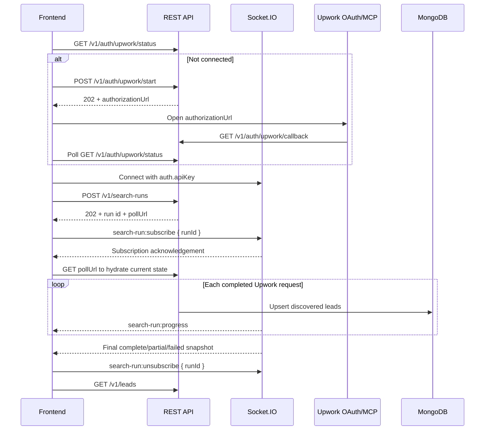

# Frontend integration guide

This guide describes the REST endpoints, Socket.IO events, response shapes, and recommended frontend flow for the Esclatech dashboard.

## Connection settings

Backend defaults:

```text
REST and Socket.IO URL: http://localhost:5050
Socket.IO path:         /socket.io
Frontend origin:        http://localhost:3000
```

The backend's `FRONTEND_ORIGIN` must exactly match the browser application's origin. REST requests and Socket.IO connections from that origin are allowed.

Every endpoint except `GET /health` and the Upwork OAuth callback requires the dashboard API key:

```http
x-api-key: <DASHBOARD_API_KEY>
```

Socket.IO sends the same key in its handshake `auth` object.

> The current API-key design is suitable for a private, trusted dashboard. A key embedded in browser JavaScript can be inspected by the browser user. Use a backend-for-frontend or short-lived user tokens before making the dashboard public.

## Endpoint summary

| Method | Endpoint | Authentication | Frontend purpose |
|---|---|---|---|
| `GET` | `/health` | None | Check whether the backend is running |
| `GET` | `/v1/auth/upwork/status` | API key | Read the current Upwork connection state |
| `POST` | `/v1/auth/upwork/start` | API key | Start or resume Upwork OAuth |
| `GET` | `/v1/auth/upwork/callback` | OAuth state | Upwork redirects the browser here; the SPA should not call it directly |
| `POST` | `/v1/auth/upwork/disconnect` | API key | Clear locally stored Upwork credentials |
| `POST` | `/v1/search-runs` | API key | Start one manual 13-keyword search run |
| `GET` | `/v1/search-runs/:id` | API key | Hydrate, recover, or poll a search run |
| `GET` | `/v1/leads` | API key | Read saved leads with pagination and filters |

## Recommended application flow



The immediate `GET pollUrl` after subscribing is important. A search starts before the `POST /v1/search-runs` response reaches the browser, so the first socket event could occur before the room subscription. Progress snapshots are cumulative, and the REST request provides authoritative recovery state.

## REST client

Create one request helper and use it for protected endpoints:

```js
const API_BASE_URL = 'http://localhost:5050';
const dashboardApiKey = 'YOUR_PRIVATE_DASHBOARD_API_KEY';

export async function apiRequest(path, options = {}) {
  const response = await fetch(`${API_BASE_URL}${path}`, {
    ...options,
    headers: {
      'Content-Type': 'application/json',
      'x-api-key': dashboardApiKey,
      ...options.headers
    }
  });

  const contentType = response.headers.get('content-type') || '';
  const body = contentType.includes('application/json')
    ? await response.json()
    : await response.text();

  if (!response.ok) {
    const error = new Error(body?.error || body || 'Request failed');
    error.status = response.status;
    error.retryAfterSeconds = body?.retryAfterSeconds;
    throw error;
  }

  return body;
}
```

Do not add `x-api-key` when calling `/health`. The OAuth callback is handled by Upwork and the backend.

## 1. Backend health

```http
GET /health
```

Response:

```json
{
  "ok": true,
  "service": "esclatech-upwork-mcp-backend",
  "scheduledCollection": false
}
```

## 2. Upwork connection

### Read connection status

```http
GET /v1/auth/upwork/status
x-api-key: ...
```

Response:

```json
{
  "connected": false,
  "credentialPresent": false,
  "orgUidAvailable": false
}
```

Treat `connected: true` as the condition that allows the user to start a search.

### Start OAuth

```http
POST /v1/auth/upwork/start
x-api-key: ...
Content-Type: application/json

{}
```

If already connected, the response is HTTP `200`:

```json
{
  "connected": true
}
```

If authorization is required, the response is HTTP `202`:

```json
{
  "connected": false,
  "authorizationUrl": "https://..."
}
```

Open `authorizationUrl` in a popup or new tab. Upwork redirects that window to `/v1/auth/upwork/callback`, which shows a plain-text success message. While the popup is open, poll `/v1/auth/upwork/status` until `connected` becomes `true` or the user cancels.

```js
export async function connectUpwork(onConnected) {
  const result = await apiRequest('/v1/auth/upwork/start', {
    method: 'POST',
    body: '{}'
  });

  if (result.connected) {
    onConnected();
    return;
  }

  window.open(result.authorizationUrl, 'upwork-oauth', 'width=720,height=760');

  const poll = window.setInterval(async () => {
    const status = await apiRequest('/v1/auth/upwork/status');

    if (status.connected) {
      window.clearInterval(poll);
      onConnected();
    }
  }, 2000);
}
```

### Disconnect

```http
POST /v1/auth/upwork/disconnect
```

Response:

```json
{
  "connected": false,
  "note": "Local tokens cleared. Revoke authorization in Upwork settings as well."
}
```

## 3. Socket.IO connection

Install the frontend client:

```bash
npm install socket.io-client
```

Create one socket singleton for the application:

```js
import { io } from 'socket.io-client';

export const socket = io(API_BASE_URL, {
  auth: {
    apiKey: dashboardApiKey
  },
  autoConnect: false
});

socket.on('connect_error', error => {
  console.error('Socket connection failed:', error.message);
});
```

Connect it before starting a search:

```js
socket.connect();
```

Socket authentication failures arrive through `connect_error` with message `unauthorized`.

### Socket events

| Direction | Event | Payload |
|---|---|---|
| Frontend → backend | `search-run:subscribe` | `{ runId }` |
| Backend → frontend | `search-run:progress` | Complete cumulative run snapshot |
| Frontend → backend | `search-run:unsubscribe` | `{ runId }` |

Subscription acknowledgement:

```json
{
  "success": true,
  "runId": "7b325f6a-f124-4e75-bff1-bbe9f191e6fc"
}
```

An invalid UUID receives:

```json
{
  "success": false,
  "error": "A valid runId is required"
}
```

## 4. Start and monitor a search run

Register the progress listener before starting the run:

```js
let activeRunId = null;

socket.on('search-run:progress', progress => {
  if (progress.id !== activeRunId) return;

  renderProgress(progress);

  if (['complete', 'partial', 'failed'].includes(progress.status)) {
    finishActiveRun(progress);
  }
});
```

Start the run:

```http
POST /v1/search-runs
x-api-key: ...
Content-Type: application/json

{
  "limit": 10,
  "keywords": ["React development", "Node.js API", "Shopify"]
}
```

`limit` must be an integer from 1 to 10 and controls the maximum jobs requested per keyword. `keywords` is optional and accepts 1–13 non-empty strings of at most 80 characters each. Entries are trimmed and duplicates are removed. When `keywords` is omitted, the backend uses its 13 configured default keywords. Do not send an empty array to request the defaults.

For a focused frontend handoff covering manual keyword input, validation, progress, and errors, see [manual-keyword-search.md](manual-keyword-search.md).

HTTP `202` response:

```json
{
  "id": "7b325f6a-f124-4e75-bff1-bbe9f191e6fc",
  "status": "running",
  "plannedRequests": 3,
  "jobsCount": 0,
  "keywords": ["React development", "Node.js API", "Shopify"],
  "pollUrl": "/v1/search-runs/7b325f6a-f124-4e75-bff1-bbe9f191e6fc"
}
```

Subscribe and immediately hydrate from REST:

```js
export async function startSearchRun(limit = 10, keywords) {
  const started = await apiRequest('/v1/search-runs', {
    method: 'POST',
    body: JSON.stringify({ limit, ...(keywords ? { keywords } : {}) })
  });

  activeRunId = started.id;

  const acknowledgement = await socket
    .timeout(5000)
    .emitWithAck('search-run:subscribe', { runId: started.id });

  if (!acknowledgement.success) {
    throw new Error(acknowledgement.error);
  }

  const currentRun = await apiRequest(started.pollUrl);
  renderProgress(currentRun);

  return currentRun;
}
```

### Progress payload

`search-run:progress` is emitted after each completed Upwork request and once more when the run reaches a terminal status.

```json
{
  "id": "7b325f6a-f124-4e75-bff1-bbe9f191e6fc",
  "status": "running",
  "startedAt": "2026-11-04T12:00:00.000Z",
  "finishedAt": null,
  "expiresAt": 1793794500000,
  "plannedRequests": 13,
  "completedRequests": 4,
  "errors": [],
  "jobs": [],
  "jobsCount": 0,
  "trigger": "manual",
  "country": "Canada",
  "keywords": ["React development", "Node.js API", "Shopify"],
  "stored": false,
  "lastCompletedSearch": {
    "keyword": "Node.js",
    "country": "Canada"
  }
}
```

Possible statuses:

| Status | Meaning |
|---|---|
| `running` | Requests are still being processed |
| `complete` | All requests completed without recorded errors |
| `partial` | The run returned some results but recorded a search, filter, quota, or MongoDB error |
| `failed` | An unexpected run-level failure occurred |

`stored` becomes `true` on the final snapshot when all discovered lead batches were saved successfully. It remains `false` if any MongoDB write failed.

### Recovery and reconnect behavior

Socket rooms are connection-specific. After a reconnect:

1. Emit `search-run:subscribe` again for `activeRunId`.
2. Call `GET /v1/search-runs/:id` to recover any missed state.
3. Continue processing socket updates.

Search-run state remains in memory for 15 minutes after completion. After expiration, `GET /v1/search-runs/:id` returns HTTP `404`.

When the run finishes, unsubscribe and refresh the leads list:

```js
async function finishActiveRun(progress) {
  const runId = progress.id;

  await socket
    .timeout(5000)
    .emitWithAck('search-run:unsubscribe', { runId });

  activeRunId = null;
  await loadLeads({ date: new Date().toISOString().slice(0, 10) });
}
```

## 5. Read saved leads

```http
GET /v1/leads
x-api-key: ...
```

With no date parameter, the endpoint returns all saved leads. Supply one of the date filter modes below to restrict results by `postedAt`.

### Lead query parameters

| Parameter | Format | Default | Notes |
|---|---|---|---|
| `page` | Positive integer | `1` | Pagination page |
| `limit` | `1`–`100` | `10` | Results per page |
| `date` | `YYYY-MM-DD` | — | One Pakistan calendar day (Asia/Karachi) |
| `month` | `YYYY-MM` | — | One Pakistan calendar month (Asia/Karachi) |
| `fromDate` | `YYYY-MM-DD` | — | Inclusive start day |
| `toDate` | `YYYY-MM-DD` | — | Inclusive end day |
| `searchedKeyword` | String, max 100 characters | — | Case-insensitive contains search against `searchedKeywords` |
| `sortBy` | `field:asc` or `field:desc` | `postedAt:desc` | Multiple values can be comma-separated |

Use only one date mode at a time:

- `date`
- `month`
- `fromDate` and/or `toDate`

Allowed sort fields are `title`, `country`, `postedAt`, `createdAt`, and `updatedAt`.

Examples:

```text
GET /v1/leads?page=1&limit=20
GET /v1/leads?date=2026-11-04
GET /v1/leads?month=2026-11
GET /v1/leads?fromDate=2026-10-01&toDate=2026-11-04
GET /v1/leads?month=2026-11&searchedKeyword=Node.js
GET /v1/leads?sortBy=postedAt:desc,title:asc
```

Frontend query builder:

```js
export async function loadLeads(filters = {}) {
  const query = new URLSearchParams();

  for (const [key, value] of Object.entries(filters)) {
    if (value !== undefined && value !== null && value !== '') {
      query.set(key, String(value));
    }
  }

  return apiRequest(`/v1/leads?${query.toString()}`);
}
```

Paginated response:

```json
{
  "data": [
    {
      "_id": "672a00000000000000000001",
      "externalId": "2117709706166172517",
      "title": "Build a Node.js API",
      "url": "https://www.upwork.com/jobs/~022117709706166172517",
      "source": "Upwork",
      "country": "Canada",
      "budget": "{\"amount\":500}",
      "jobType": "Fixed-price",
      "duration": "1 to 3 months",
      "postedAt": "2026-11-04T09:30:00.000Z",
      "hasAttachments": true,
      "searchedKeywords": ["Node.js", "API development"],
      "skills": ["Node.js", "MongoDB"],
      "summary": "Build an API for an existing product.",
      "lastSearchRunId": "7b325f6a-f124-4e75-bff1-bbe9f191e6fc",
      "createdAt": "2026-11-04T12:00:00.000Z",
      "updatedAt": "2026-11-04T12:05:00.000Z"
    }
  ],
  "page": 1,
  "limit": 10,
  "totalPages": 1,
  "totalResults": 1
}
```

## Error handling

REST errors use this shape:

```json
{
  "error": "Human-readable error message"
}
```

Rate-limit errors may also include:

```json
{
  "error": "Local Upwork safety limit reached (minute); retry later",
  "retryAfterSeconds": 30
}
```

Important status codes:

| Status | Meaning | Frontend behavior |
|---|---|---|
| `400` | Invalid body or query filter | Show the validation message near the relevant control |
| `401` | Missing or incorrect API key | Stop requests and return to authentication/configuration state |
| `404` | Unknown route or expired search run | Clear the stale active run and reload leads |
| `409` | Another search run is already active | Show the existing-run message and avoid starting another run |
| `429` | Local quota limit | Display retry time when provided |
| `500` | Backend, MongoDB, OAuth, or MCP failure | Show a generic retry message and log the request context |

## UI state recommendations

Keep these states separate in the frontend:

```js
{
  backendHealthy: false,
  upworkConnected: false,
  socketConnected: false,
  activeRun: null,
  leads: [],
  leadPagination: {
    page: 1,
    limit: 10,
    totalPages: 0,
    totalResults: 0
  },
  leadFilters: {
    date: null,
    month: null,
    fromDate: null,
    toDate: null,
    searchedKeyword: '',
    sortBy: 'postedAt:desc'
  }
}
```

Disable the “Start Search” button while `activeRun.status === 'running'`. After a terminal snapshot, refresh `/v1/leads` because MongoDB persistence happens before each progress event is emitted.
